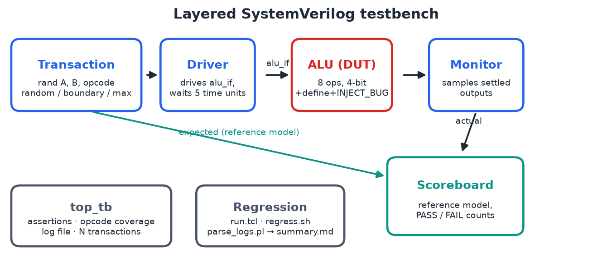
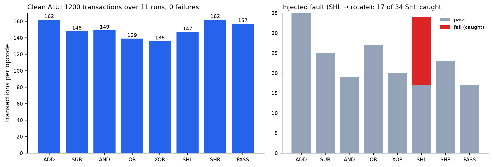

# Verification of a 4-bit ALU using Constrained-Random Testing in SystemVerilog

**A layered, self-checking SystemVerilog testbench that runs 1,200 random transactions with zero false alarms, and catches a deliberately planted bug.**


<p align="center">
  
</p>

## What it does

A 4-bit combinational ALU with eight operations is verified with a UVM-style, class-based testbench. A transaction class generates constrained-random stimulus, a driver and monitor talk to the DUT through a virtual interface, and a scoreboard compares every result with a reference model. Immediate assertions, per-opcode functional coverage and a log file come with every run. A TCL script runs the whole flow in ModelSim with one command, and a Bash + Perl regression turns many runs into one summary table.

## Highlights

- **Three stimulus modes:** random, boundary (A=0, B=15) and maximum (A=15, B=15), selected per transaction.
- **Self-checking:** scoreboard reference model *and* immediate assertions check every result.
- **Coverage-driven:** opcode and stimulus-mode coverage per run. The regression shows which seeds reach all 8 opcodes.
- **Bug injection:** `+define+INJECT_BUG` turns shift-left into a rotate, to prove the testbench catches real faults.
- **Scripted end to end:** `run.tcl` (compile, simulate), `regress.sh` (multi-seed, long run, bug run), `parse_logs.pl` (summary table).

## Results



| Run | Transactions | Pass | Fail | Opcode coverage |
|---|---|---|---|---|
| Seeds 1–10, 20 transactions each | 200 | 200 | 0 | 8/8 in 5 of 10 seeds |
| Seed 42, long run | 1000 | 1000 | 0 | 8/8 |
| Seed 42, ALU with injected shift-left fault | 200 | 183 | **17** | 8/8 |

- **No false alarms:** 1,200 transactions on the correct ALU, 0 failures, 0 assertion errors.
- **Every real failure caught:** the injected fault only matters when A[3] = 1. The scoreboard and the assertions flag exactly those 17 of the 34 shift-left transactions, e.g. `A=9 opcode=5: expected 2, got 3`.
- **Coverage depends on length:** at 20 transactions, half the seeds miss an opcode (as the report's own run missed ADD). More transactions or more seeds close the gap. That is the reason to run a regression, not one test.

Full table: [`results/summary.md`](results/summary.md).

## The DUT

| Opcode | Operation | Result |
|---|---|---|
| 000 | Addition | `A + B` (carry discarded) |
| 001 | Subtraction | `A - B` (mod 16) |
| 010 | AND | `A & B` |
| 011 | OR | `A \| B` |
| 100 | XOR | `A ^ B` |
| 101 | Shift left | `A << 1` |
| 110 | Shift right | `A >> 1` |
| 111 | Pass through | `A` |

## Repository layout

```
rtl/        alu.sv (DUT, optional INJECT_BUG)
tb/         interface.sv, transaction.sv, driver.sv, monitor.sv, scoreboard.sv, top_tb.sv
scripts/    run.tcl, regress.sh, parse_logs.pl, make_figures.py
results/    runs/<name>.transcript and .sim.log, summary.md
logs/       sim.log from the last run
original/   the team's testbench files and ModelSim transcript (17 Apr 2026)
docs/       HOW_TO_RUN.md, images/
report/     submitted report (PDF)
```

## Running it

ModelSim set-up, single runs, seeds, bug injection and the full regression: see **[docs/HOW_TO_RUN.md](docs/HOW_TO_RUN.md)**.

## Report

[`report/ALU_Verification_Final_Report.pdf`](report/ALU_Verification_Final_Report.pdf): the submitted report. The team's original testbench and transcript are in [`original/`](original/).

## Team

BEVD205L Scripting Languages & Verification, VIT Vellore (Slot A2, Team 6).

| Name | Reg. No. |
|---|---|
| Aditya Manoj (group lead) | 24BVD0070 |
| Arrnav Trisal | 24BVD0064 |
| Gavin Fernandes | 24BVD0083 |
| Ashmit Singh | 24BVD0027 |
